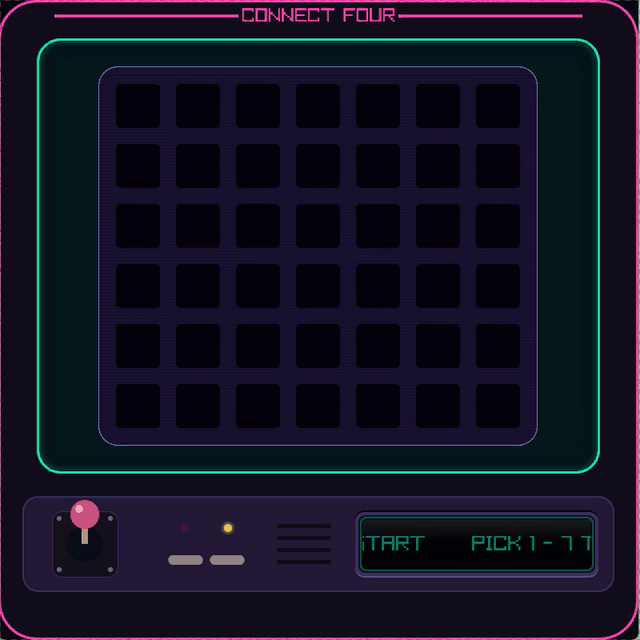

# Connect Four (C + raylib)

A two-player Connect Four game written in C with the [raylib](https://www.raylib.com/) graphics library, styled to look like it is running on a small arcade cabinet.

I made this as a first-year university student to practise C, and it grew from a plain text-book style game into something I actually enjoyed polishing.



## How to play

- Two players share one keyboard: Pink and Yellow. A random player goes first.
- Press 1 to 7 (or the numpad keys) to drop a piece into that column.
- Connect four pieces in a row (across, up and down, or diagonally) to win. If the board fills up, it's a draw.
- Press R at any time to restart.

The joystick and most of the buttons on the cabinet are just decoration. The two small lights show whose turn it is, and the little screen at the bottom right scrolls the result.

## Features

**Game**
- Player vs player Connect Four on a 7 x 6 board
- Win detection in all four directions, plus draw detection
- Restart at any time

**Visuals and effects** (everything is drawn with raylib shapes, there are no image files)
- Arcade cabinet with a header, a screen, a control panel with a joystick and buttons, and a base
- Square-holed board with glowing pieces and a small shine on each piece
- Scanlines (slowly moving), a soft vignette and a pulsing glow around the screen
- Pieces fall into the board with a simple gravity animation
- A small burst of particles when a piece lands
- The four winning pieces flash and the other pieces dim
- A small scrolling-text screen that shows how to play and the result (glows when the game ends)

## Build and run

You need a C compiler (gcc), [raylib](https://github.com/raysan5/raylib) 5.5 or newer, and `make`.

**Windows** (the official raylib installer includes everything needed):

```
make
./connect4.exe
```

If `make` isn't found, try `mingw32-make`. If the compiler can't find raylib, tell it where raylib is:

```
make RAYLIB_PATH=C:/raylib/raylib/src
```

**Linux:** install raylib (the raylib wiki lists the packages it needs), then run `make` and `./connect4`. 
The Makefile also has macOS settings, but I haven't tested those.

**Without make** (Windows example):

```
gcc main.c connect.c cabinet.c -o connect4.exe -I C:/raylib/raylib/src -L C:/raylib/raylib/src -lraylib -lopengl32 -lgdi32 -lwinmm
```

Tested on Windows 11 and Ubuntu 26.04.

## Project structure

| File | What it does |
|---|---|
| main.c | Opens the window, reads the keyboard, runs the main loop and decides what order things are drawn in |
| connect.c / connect.h | The game rules (placing pieces, checking for a win or draw), plus drawing the board, the falling piece and the particles |
| cabinet.c / cabinet.h | Drawing the arcade cabinet and the screen effects. It doesn't know anything about the game rules, it is only told whose turn it is and what message to show |

## How it works

- **The board** is a 2D array of ints (0 empty, 1 or 2 for a player). Dropping a piece finds the lowest empty cell in the chosen column.
- **Win check:** after each piece is placed, the code counts matching pieces in both directions along the four lines through that piece (horizontal, vertical and the two diagonals). Four or more is a win. The winning cells are stored so they can flash.
- **Drawing:** the whole screen is redrawn every frame, bottom layer first: cabinet, then board, then falling piece and particles, then screen effects such as scanlines on top.
- **Animations** use the time since the last frame, so they run at the same speed whatever the frame rate. A key press starts a falling piece, and the real move is only made when the piece lands.

## How the project developed

1. **Picking a project.** I wanted to make a game and chose Connect Four because the rules for a two-player version are simple to code.
2. **The game logic.** I wrote the board, the piece dropping and the win and draw checks first, with a very basic window that only showed the board.
3. **A better look.** I wanted it to look more interesting, so I redesigned it as an arcade cabinet: first the layout and zones, then the body, screen, control panel and base, then the board and pieces.
4. **Effects.** I added the scanlines, glow, vignette, turn lights, piece shine and the win flash.
5. **Animation.** I added the particle burst, the falling pieces and the scrolling message screen.
6. **Tidying.** I split the code into separate files, moved the numbers and colours into named constants, and fixed a lot of compile errors along the way.

## What I learned

- Splitting a C program into several files with headers, and why the compiler needs prototypes
- Using structs, arrays and pointers to hold game state
- Drawing in layers with raylib, and animating with time instead of frame counts
- Reading compiler errors and fixing them (missing declarations, mismatched function types, misplaced braces)

## Known issues and limitations

- Only two human players, and there is no menu or score tracking
- Key presses are ignored while a piece is falling
- connect.c mixes the game rules with drawing code. I'd like to separate them but am a little lazy
- No automated tests, I only tested by playing
- Not tested on macOS

## Future plans

- **Player vs bot:** a computer opponent that always picks the best move. I plan to read about the minimax algorithm for this.
- A web version so it can be played in the browser
- A start menu, score tracking and sound effects
- Mouse controls

## Credits and honesty note

Built with [raylib](https://www.raylib.com/). I wrote the game logic from scratch. For the visual side I used AI assistants. I'm happy to explain any part of the code.
